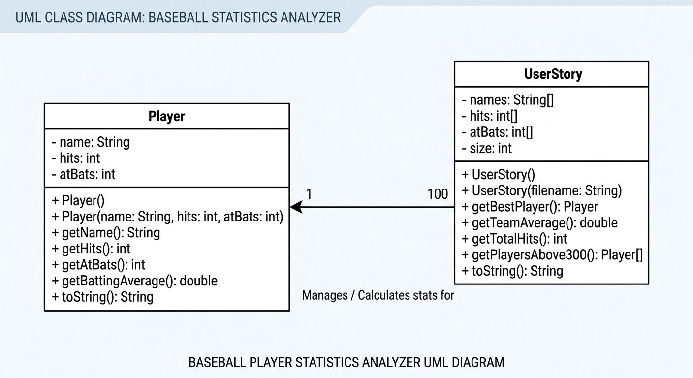

# Data-for-Social-Good-Project
# Unit 2 - Data for Social Good Project

## Introduction

Software engineers develop programs to work with data and provide information to a user. Each user has different needs based on the information they are looking for from data. Your goal is to create a data analysis program for your user that stores and analyzes data to provide the information they need.

## Requirements

Use your knowledge of object-oriented programming, one-dimensional (1D) arrays, and algorithms to create your data analysis program:
- **Write a class** – Write a class to represent your user or business and store and analyze their data with no-argument and parameterized constructors.
- **Create at least two 1D arrays** – Create at least two 1D arrays to store the data that your user needs information about.
- **Write a method** – Write a method that finds or manipulates the elements in a 1D array to provide the information your user needs.
- **Implement a toString() method** – Write a toString() method that returns general information about the data (for example, number of values in the dataset).
- **Document your code** – Use comments to explain the purpose of the methods and code segments and note any preconditions and postconditions.

## User Story 

Include your User Story you analyzed for your project here. Your User Story should have the following format: 

> As a student playing baseball,   
> I want to analyze Major League Baseball player statistics from a data file,   
> so that I can evaluate top-performing professional hitters, calculate benchmark batting metrics, and identify players hitting .300 or higher.

## Dataset 

Dataset: [https://sabr.org/lahman-database/](https://sabr.org/lahman-database/)

- **Name** (String) - full name of the MLB player
- **Hits** (int) - total number of base hits recorded by the player
- **AtBats** (int) - total number of official at-bats for the player
 

## UML Diagram 

 

## Description 

This project implements a Baseball Statistics Analyzer using object-oriented programming principles in Java. To address the User Story, I created a Player class to encapsulate individual player data (name, hits, and atBats) using private instance variables, overloaded constructors (both a no-argument constructor and a parameterized constructor), accessor methods, and a getBattingAverage() method that uses type casting (double) to prevent integer division.

As a student athlete playing baseball at Chatsworth Charter High School, analyzing data from Major League Baseball players provides great benchmark metrics and insights into elite hitting performance. The UserStory class serves as the primary data analysis engine for the dataset. Using the Scanner class and File I/O inside a try-catch block, the parameterized constructor reads players.txt, uses String.split(",") to parse each line, and populates three parallel one-dimensional (1D) arrays (names[], hits[], and atBats[]). To fulfill our analytical goals, the class implements several traversal algorithms using for loops:
- getBestPlayer() performs a linear search to locate the index of the player with the highest batting average and returns a new Player object.
- getTeamAverage() and getTotalHits() accumulate values across the arrays to compute aggregate dataset metrics.
- getPlayersAbove300() uses a two-pass algorithm to count qualifying players and dynamically instantiate a new Player[] array containing only players hitting .300 or higher.

Finally, Main.java instantiates the UserStory object and calls its overridden toString() method alongside the analysis methods to print a formatted summary of the MLB statistics to the console.